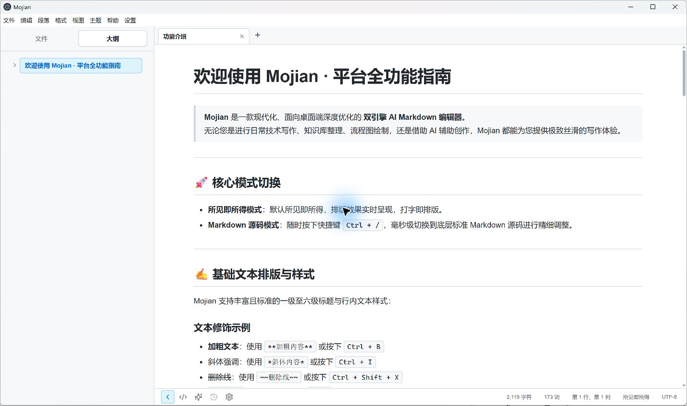

# Mojian — AI Markdown Studio

<div align="center">

**现代化双引擎 AI Markdown 编辑器 · 专为高效写作与知识管理打造**

[](https://github.com/li-shun-code/mojian/releases)
[](https://github.com/li-shun-code/mojian/actions)
[](LICENSE)
[]()

</div>

## 应用截图



---

## ✨ 核心特性

- ✍️ **所见即所得 & 源码双模式**：基于现代富文本核心与 Markdown 引擎，毫秒级无缝切换。
- 🔎 **查找与替换**：当前文档支持上/下一个匹配、替换当前项与全部替换；工作区支持 Markdown 全文搜索，并可选大小写、全词和正则。
- 🤖 **内置 AI 创作助手**：
  - 支持 **问答、润色、扩写、精简、翻译、校对、续写、摘要** 等多种 AI 操作。
  - 多轮会话保留上下文；AI 可按需搜索、读取和编辑长文，修改先预览，再由用户应用。
  - 自动注入本机写作记忆，支持从范文提炼并保存个人写作偏好。
  - 自定义 API 接入（支持 OpenAI 规范兼容接口及模型配置）。
- 📊 **强大的富文本与图表支持**：
  - **Mermaid 流程图 / 时序图 / 类图**：实时渲染，支持全屏预览、缩放平移、导出与复制 SVG 源码。
  - **KaTeX 数学公式**：支持行内及独立块级数学公式渲染。
  - **代码高亮与行号**：支持主流编程语言语法高亮及一键复制代码。
  - **交互式表格**：支持右键菜单插入行、插入列、格式化表格。
  - **任务清单与多级标题**：轻松组织任务与思维导图式内容。
- 📂 **工作区与文件管理**：
  - 目录树多级浏览，一键切换工作区。
  - 实时提取文档大纲（Outline），点击标题平滑定位。
  - 单窗口多文档标签页；支持关闭当前、左右侧或全部标签。
  - 已命名文档自动保存，并提供版本历史和恢复。
  - 应用菜单内置“**打开最近文件**”浮动二级子菜单（保留最近 20 条记录，支持一键清空）。
  - **意外恢复与草稿保护**：毫秒级自动快照，防止断电或意外退出导致的内容丢失。
- 📄 **多格式导出与打印**：
  - 支持 **HTML、PDF、Word（DOCX）** 导出及系统原生打印，保留文档图片和公式/流程图。
- 🎨 **舒适的设计与交互**：
  - 专注模式（F8）淡化非当前段落并隐藏侧栏；打字机模式（F9）将光标所在行保持在屏幕中央。
  - 内置 GitHub、Gothic、Newsprint、Night、Pixyll、Whitey 六款 Typora 经典主题，并支持导入自定义 CSS 主题。
  - 兼容 Typora / 经典编辑器的常用快捷键体系。

---

## ⌨️ 常用快捷键

| 操作 | 快捷键 | 操作 | 快捷键 |
| :--- | :--- | :--- | :--- |
| **保存** | `Ctrl + S` | **另存为** | `Ctrl + Shift + S` |
| **新建文档** | `Ctrl + N` | **打开工作区** | `Ctrl + Shift + O` |
| **切换源码模式** | `Ctrl + /` | **文档查找 / 替换** | `Ctrl + F / Ctrl + H` |
| **工作区全文搜索** | `Ctrl + Shift + F` | **上一个 / 下一个匹配** | `Shift + F3 / F3` |
| **专注 / 打字机模式** | `F8 / F9` | **显示/隐藏侧栏** | `Ctrl + Shift + L` |
| **一级 ~ 六级标题**| `Ctrl + 1 ~ 6` | **正文段落** | `Ctrl + 0` |
| **加粗** | `Ctrl + B` | **斜体** | `Ctrl + I` |
| **删除线** | `Ctrl + Shift + X` | **行内代码** | `Ctrl + Shift + \`` |
| **插入链接** | `Ctrl + K` | **代码块** | `Ctrl + Shift + K` |
| **无序列表** | `Ctrl + Shift + 8` | **有序列表** | `Ctrl + Shift + 7` |
| **任务列表** | `Ctrl + Shift + 9` | **引用块** | `Ctrl + Shift + Q` |
| **放大 / 缩小** | `Ctrl + + / -` | **打印** | `Ctrl + P` |

Windows 安装版会注册 Markdown 文件类型。需要把 Mojian 设为默认打开程序时，选择“文件 → 默认应用设置”，再在 Windows 设置中将 `.md` 关联到 Mojian；便携版需要通过 Windows“打开方式”手动选择。

---

## 🛠️ 技术栈

- **框架内核**：[Electron 38](https://www.electronjs.org/) + [React 19](https://react.dev/) + [TypeScript 5](https://www.typescriptlang.org/)
- **构建工具**：[electron-vite](https://electron-vite.org/) + [Vite 6](https://vitejs.dev/)
- **富文本引擎**：[Tiptap 3](https://tiptap.dev/) + [CodeMirror / Lowlight](https://highlightjs.org/)
- **图表与公式**：[Mermaid](https://mermaid.js.org/) + [KaTeX](https://katex.org/)
- **测试体系**：[Vitest](https://vitest.dev/) (单元测试) + [Playwright](https://playwright.dev/) (端到端 E2E 测试)
- **CI / CD**：GitHub Actions 自动化多平台矩阵打包（Windows & macOS）

---

## 🚀 本地开发与调试

### 环境要求
- Node.js >= 20.0.0
- npm >= 10.0.0

### 安装与运行
```bash
# 1. 克隆仓库
git clone git@github.com:li-shun-code/mojian.git
cd mojian

# 2. 安装依赖
npm install

# 3. 启动本地开发环境 (支持热重载)
npm run dev
```

### 运行测试与校验
```bash
# 执行单元测试
npm test

# 执行端到端 E2E 自动化测试
npm run test:e2e

# 执行代码风格与语法检查
npm run lint

# 执行 TypeScript 类型校验
npm run typecheck
```

---

## 📦 打包与分发

项目配置了完整的本地打包与 GitHub Actions 自动化云打包支持：

### 1. 本地打包
```bash
# 打包 Windows 安装包 (NSIS 安装程序与绿色免安装版)
npm run dist:win

# 打包 macOS 安装包 (DMG 与 ZIP 格式，需在 macOS 环境执行)
npm run dist:mac
```
构建产物将输出在 `release/` 目录下。

### 2. GitHub Actions 自动化打包
- 每次提交或创建 Pull Request 时，GitHub Actions 会自动进行跨平台构建与测试。
- 推送版本标签（例如 `v0.2.0`）即可自动触发云端多平台编译并在 [Releases](https://github.com/li-shun-code/mojian/releases) 页面发布最新的安装程序。

---

## 📄 开源许可

本项目基于 [MIT License](LICENSE) 开源。
